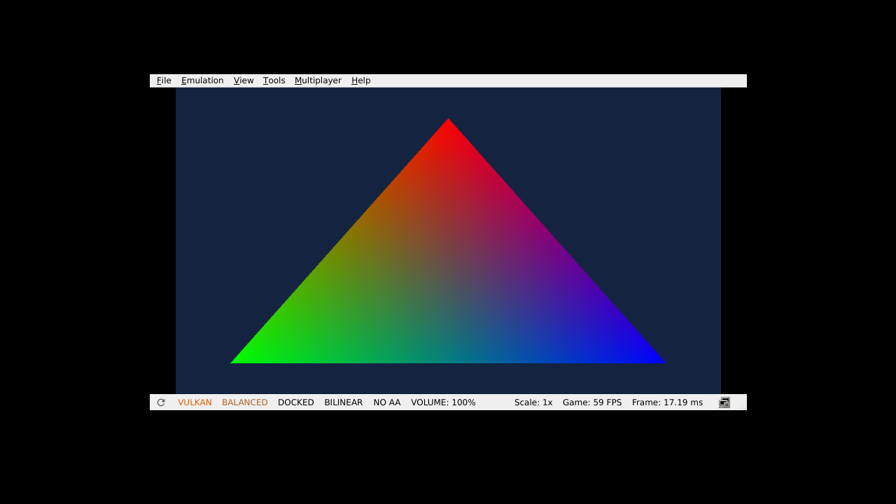

# GoldenEye NX — ARM64 / Fast3D / deko3d, 2026-10-20

## Result

The `dkQueueCreate()` blocker is bypassed in **unmodified official Eden 0.2.1** by independently uploading each exported deko3d MME macro suffix. The guest returns from queue creation and submits 120+ diagnostic frames. A screenshot shows the generated RGB triangle with the Eden status bar reporting 60 FPS.

This is a real ARM64 Switch NRO executing deko3d commands, **not GoldenEye gameplay, a game display list, or physical Switch validation**.



## Preserved work

- Started at PR #24 head `869cef26cfa6c91ff881c69ac67cab31aa6fe0e6`, branch `feat/goldeneye-native-engine-integration`.
- Reviewed PR #13 (ROM validation, logo decoder, input, crossbuilds) and PR #19 (deko3d bootstrap). Their branches are unchanged.
- `d932006` is absent from this clone. No claim is made about its content; this session does not overwrite or recreate it.
- The supplied USA ROM passed the existing private load/CRC/CIC and logo decoding checks. ROM and decoded assets stay outside Git.

## Queue diagnosis

1. The SDK diagnostic reaches `queue-create-lean-start`; Eden throws `std::bad_alloc` or `std::length_error`.
2. Unmodified switchbrew `deko_basic`, built from `669786898205b7beb25ff1731e72982e6d0397d3`, throws the same length error.
3. GDB cannot start its inferior (`ptrace: Operation not permitted`). An in-process `__cxa_throw` observer captures the stack instead, without changing guest instructions or recovering exceptions.
4. Eden release binary build ID `c30f1493fd0259834c9b13b7c7d072a5805af1fb` fails at offsets `0xedc078`, `0xcbaee2`, `0xcb965b`, `0xd2df6a`. Disassembly shows vector resizing after insertion into a compact map.
5. Eden v0.2.1 source, mirror commit `58c1e20ee58efa3900ba616207d460886214480b`, has the corresponding `MacroEngine::Execute` mid-macro path. It retains a vector reference inside `ankerl::unordered_dense::map`, inserts another entry, then reads the invalidated reference. The pinned dependency `7b55cab8418da1603496462ce3ccdb4cb1dc3368` reproduces this as an ASan **heap-use-after-free** in the isolated regression.
6. `patches/eden/v0.2.1-macro-cache-lifetime.patch` materializes the suffix before insertion and fixes a separate stale/end iterator in macro dumping. **The isolated corrected algorithm passes; a complete patched Eden executable was not built.**
7. The optional dekotools patch avoids mid-macro extraction by uploading every exported suffix directly. GPU instruction addresses/bytes and entry bindings remain identical: **181 instructions / 14 exports**, checked byte for byte. Queue command memory remains 64 KiB.
8. A second baseline compiled from the **same pinned deko3d source**, with the original generator, still fails. With the modified generator, queue creation returns and the triangle appears. A repeat without the exception observer also renders the triangle and reaches 120+ frame submissions. The earlier repeat is `triangle-repeat-without-observer.png`; the final trace-reset fix is captured in `triangle-fresh-profile.png`, with its NRO hash in `manifest.json`.

The Work environment exposes Mesa 25.2.8 llvmpipe software Vulkan, no physical GPU. The status bar varied between 1 and 60 FPS across captures; stable performance has not been benchmarked. The screenshot proves a rendered diagnostic, not 60 FPS game performance. The observer also saw caught Vulkan exceptions during the successful run; this is not treated as a validated long-term stability result.

## Fresh-profile startup regression

The first remote Eden run exposed a separate failure before the first guest trace. A SIGSEGV observer localized it to the emulator's filesystem `DeleteDirectory` path: our new trace reset used newlib `remove()` on a nonexistent file before creating its parent directories. The fallback directory-delete request reached a null parent in Eden. Existing local SD directories had hidden this problem.

Commit `a74139e` creates the trace parents and truncates the file using `fopen(..., "w")`, avoiding that request. A completely empty local XDG data/config profile then rendered the triangle and submitted 120+ frames; `triangle-fresh-profile.png` and `guest-fresh-profile.txt` record this test. CPU fastmem experiments did not resolve the filesystem failure and were removed. CI uses ordinary CPU defaults and isolated XDG paths.

The NRO downloaded from the successful CI ARM64 build was also executed locally and rendered correctly. That confirms the remote build artifact separately from the remote emulator run. The remote tests/build passed; final cold-profile Eden CI results must be read at the run linked from PR #24. No failed execution is treated as a pass.

## Incremental engine-facing code

`nxlab/native/goldeneye_n64_memory.[ch]` implements an explicit 8 MiB arena with bounded physical, PC-port V1, KSEG0/KSEG1 and reverse translations, plus Fast3D segments. Segment 5 precedence and tagged offsets follow the upstream convention. Unknown addresses, unbound segments and overflow fail before returning a pointer.

The NRO stages its generated VBO in this arena and verifies physical/KSEG0 aliasing before the bridge. **This does not make direct engine dereferences at fixed addresses safe.** Upstream `dram.c`, absolute `dram_syms.S`, cart mappings and direct pointer conversions still need a coordinated adaptation, compared with the unavailable local work.

`nxlab/engine_adapter/goldeneye_gfx_subset.[h|cpp]` compiles against the real `GfxRenderingAPI` header at GoldenEye PC Port `fda76b69837e6c5aae436e0d3e798989e49b06d2`. All current callbacks are assigned. Unsupported operations latch an error until reinitialization and suppress later draws.

Only canonical single-cycle SHADE RGB (`id0=0x1000`, `id1=0`), full-screen viewport/scissor and no depth/alpha/textures are accepted. Tests verify this shader ID with upstream `gfx_cc.cpp`. The NRO calls the API, which feeds the validated VBO bridge and deko3d vertex memory. The sink consumes input before GPU use; there is no dynamic fenced streaming yet.

**The full `gfx_pc.cpp` interpreter and reconstructed game engine are not linked into this NRO.** Existing ARM64 interpreter crossbuilds are preserved. The new arena transport is not connected to the game's fixed-address ABI.

## Reproduce

Install devkitA64, libnx, deko3d, uam, native C/C++ compilers, Python 3, meson, ninja, flex, bison, make and git. Set `DEVKITPRO` normally. Check out the pinned PC port outside this repository:

```sh
python3 scripts/build_goldeneye_deko_compat.py \
  --work-dir <fresh-build-directory> --upstream <pinned-pc-port-checkout>
```

The script fetches exact deko3d/dekotools commits, builds an original header, applies the upload patch in its own checkout, compares GPU RAM images, and builds `nxlab/switch_deko_smoke/goldeneye-deko-mme.nro`. **The complete script was executed successfully locally.** Installed SDK libraries are not replaced.

The ordinary SDK build remains `make -C nxlab/switch_deko_smoke`. Use separate `BUILD` directories when changing compile-time options. All diagnostic NROs contain only generated geometry and open-source shaders.

## Verification and remaining gates

- Existing Python suite: 92 tests, 1 skipped.
- Native input, Fast3D bridge, private ROM and private logo checks pass.
- New N64 translation, upstream API and pinned macro-cache tests pass under ASan/UBSan. The original macro-cache pattern fails under ASan as expected. LeakSanitizer is disabled locally because process inspection is unavailable; GitHub Actions retains normal settings.
- Real ARM64 loader, SDK diagnostic, adapter diagnostic, official deko_basic, source baseline and MME compatibility diagnostic compile. DKSH shaders are generated with uam.
- The final NRO contains the memory translator and real rendering API adapter symbols.
- Updated CI builds both SDK/MME diagnostics and executes the MME version in Eden. Submission markers are necessary; captured pixels require separate inspection. Remote CI results must be checked after push.

Remaining gates: full engine memory/host ABI, real display lists, dynamic fenced buffers, combiner/textures/depth/blending, input/audio, and the first mission. **The first mission objective is not achieved. Physical Switch execution is untested.**

Evidence: `docs/evidence/goldeneye-20261020/`. No ROM, original assets, firmware, keys or proprietary data are included.

## Sources and licenses

- GoldenEye PC Port: https://github.com/jkdansereau/goldeneye-pc-port
- deko3d: https://github.com/devkitPro/deko3d
- dekotools: https://github.com/fincs/dekotools — GPL-3.0; source patch retains upstream obligations.
- Eden source: https://git.eden-emu.dev/eden-emu/eden/src/tag/v0.2.1/src/video_core/macro.cpp — its GPL-3.0-or-later/GPL-2.0-or-later source notices apply to the patch.
- Official diagnostic: https://github.com/switchbrew/switch-examples/tree/master/graphics/deko3d/deko_basic

Third-party source is fetched for builds, not vendored. Patches do not relicense the rest of lab-NX.
